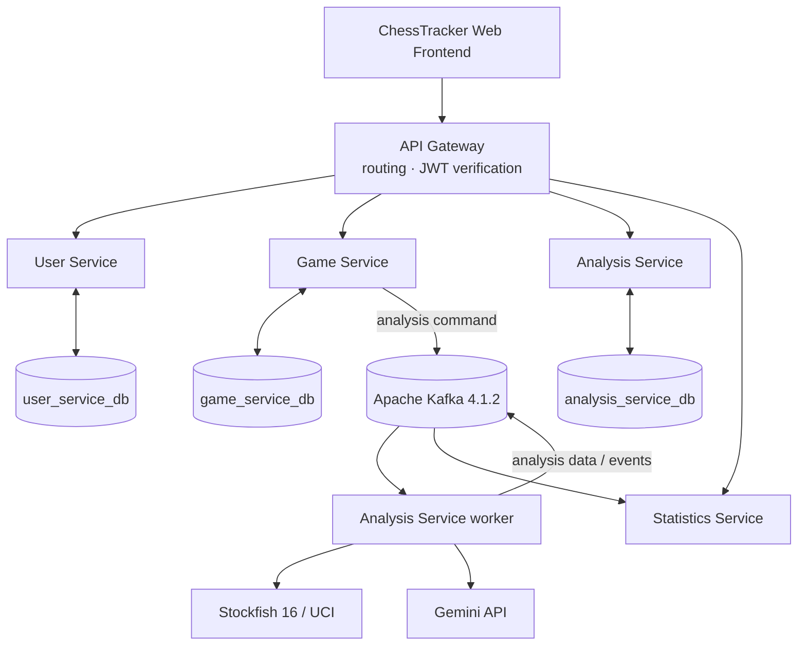

<div align="center">

# ♟️ ChessTracker

### A chess platform powered by Java, Stockfish, Kafka, and AI explanations.

**Analyse your games. Discover your playing style. Build a chess profile backed by data and AI.**

[](https://openjdk.org/)
[](https://spring.io/projects/spring-boot)
[](https://www.postgresql.org/)
[](https://kafka.apache.org/)
[](https://www.docker.com/)

[Architecture](#-architecture) · [Services](#-the-microservices) · [Security](#-security-model) · [Run locally](#-run-locally) · [Documentation](#-project-documentation)

</div>

---

## ♟️ What is ChessTracker?

ChessTracker is a chess analysis platform built around a complete player workflow: import and manage games, analyse positions with Stockfish, understand mistakes through AI-generated explanations, track performance statistics, and discover a personal chess identity through an AI-generated Chess Portrait. A dedicated web frontend will bring these capabilities together in one player-facing experience.

The system is split into independent Spring Boot services. Each service has a clear domain, its own persistence boundary, and a defined way to communicate with the rest of the platform. HTTP handles request/response operations; Kafka connects work that can run asynchronously.

> **Project scope:** ChessTracker brings together microservices, RSA-based authentication, event-driven processing, a persistent Stockfish/UCI integration, and Gemini-powered explanations in one coherent backend project.

## ✨ Highlights

- **Real chess calculation:** Stockfish performs engine analysis through UCI; the LLM is used for explanations rather than replacing chess logic.
- **Asynchronous workflows:** Kafka separates analysis tasks from the initial game request.
- **Player statistics:** track results, performance by situation, average accuracy, brilliant moves, and other metrics derived from games and engine analysis.
- **Chess Portrait:** an AI-generated profile of a player’s style, with a concise description, a short style label such as *Attacking* or *Positional Defender*, and a comparison to a well-known player with a similar style.
- **A dedicated web frontend:** a player-facing interface for games, analysis, performance dashboards, and the Chess Portrait.
- **Domain-oriented services:** account management, game data, analysis, and statistics have separate responsibilities.
- **Token-based security:** User Service signs RSA JWTs; the Gateway validates tokens and propagates trusted identity.
- **Versioned persistence:** PostgreSQL and Liquibase provide relational storage and managed schema changes.
- **Containerized dependencies:** local PostgreSQL and Kafka run through Docker Compose.

## 🧭 Architecture



The main flow is straightforward: the web frontend communicates with the backend through the Gateway; domain services manage accounts, games, analysis, and statistics; Kafka carries asynchronous work; Analysis Service combines Stockfish calculation with Gemini explanations; Statistics Service turns game and analysis data into performance metrics and a player profile.

## 🧩 The microservices

| Repository | Responsibility | Main technologies |
|---|---|---|
| [User Service](https://github.com/illia-krupko/chess-tracker-user-service) | Registration, login, profiles, account lifecycle, access JWTs | Spring Security, JOSE/JWT, PostgreSQL, Liquibase |
| [Game Service](https://github.com/illia-krupko/chess-tracker-game-service) | Game-domain operations, PGN and chess data, persistence, analysis messaging | Spring Data JPA, PostgreSQL, Kafka, chesslib |
| [Analysis Service](https://github.com/illia-krupko/chess-tracker-analysis-service) | Engine-backed analysis and natural-language explanations | Stockfish/UCI, Kafka, Gemini, PostgreSQL |
| [Statistics Service](https://github.com/illia-krupko/chess-tracker-statistics-service) | Performance metrics, game-pattern statistics, and AI-generated Chess Portrait | Spring MVC, PostgreSQL, Kafka, Liquibase |
| [API Gateway](https://github.com/illia-krupko/chess-tracker-api-gateway) | Routing, token verification, trusted identity propagation | Spring Cloud Gateway Server MVC, Spring Security |
| [Infrastructure](https://github.com/illia-krupko/chess-tracker-infrastructure) | PostgreSQL, Kafka, Docker networks, persistent volumes | Docker Compose, PostgreSQL 17, Kafka 4.1.2 |

Each repository has its own README with configuration details and service-specific instructions.

## 📈 Player analytics and Chess Portrait

ChessTracker is not limited to storing games or showing engine evaluations. Its player-facing value is in connecting individual games to a broader picture of how someone plays.

### Performance statistics

Statistics Service is responsible for player-level metrics such as:

- Win, draw, and loss rates, including breakdowns by colour, opening, and other game situations.
- Average accuracy and accuracy trends across games or time periods.
- Brilliant-move counts and other engine-derived indicators.
- Performance patterns that help players see where they perform well and where they struggle.
- Historical progress and summaries built from game results and analysis data.

Metrics should have explicit definitions and be calculated consistently from the available game and engine data. A metric is shown only when the underlying data supports it.

### ♟️ Chess Portrait — a personal playing-style profile

Chess Portrait is a signature ChessTracker feature: an AI-generated, readable description of how a player tends to play, based on their statistics and optionally a selection of games from different periods. It is designed to turn raw numbers into a coherent picture of a player’s chess identity.

A Chess Portrait combines three elements:

1. **Style summary:** a short description of the player’s recurring tendencies, strengths, and characteristic decisions.
2. **Style label:** a concise category such as *Attacking Player*, *Positional Defender*, or another label supported by the observed play.
3. **Player-style comparison:** a well-known chess player whose style most resembles the user’s, with an explanation of the similarities rather than just a name.

The AI interprets evidence from statistics and selected games; it does not replace Stockfish’s calculation. The comparison is an illustrative similarity, not a claim that the player has the same strength or skill as a grandmaster.

### 🖥️ Web experience

A dedicated frontend connects the system into one product experience: game management, game analysis, performance dashboards, and the Chess Portrait. The backend services expose the domain capabilities; the frontend presents them in a clear, player-friendly way.

## 🛠️ Technology stack

| Area | Technologies |
|---|---|
| Language & runtime | Java 21 |
| Application framework | Spring Boot 4.1.1, Spring Security |
| Persistence | PostgreSQL 17, Spring Data JPA / Hibernate, Liquibase |
| Messaging | Apache Kafka 4.1.2 in KRaft mode |
| Chess analysis | Stockfish 16 through UCI |
| AI explanations | Gemini API |
| API ingress | Spring Cloud Gateway Server MVC, OAuth2 Resource Server / JWT |
| Build & quality | Gradle, JUnit, Testcontainers, Checkstyle, MapStruct, Lombok, springdoc-openapi |
| Runtime | Docker Compose, service-specific Docker networks |

## 🔐 Security model

1. User Service authenticates credentials and signs an access JWT with the RSA private key.
2. The Gateway validates the token with the matching RSA public key.
3. The Gateway derives the authenticated user ID from the verified token and sets `X-User-Id` on protected routes.
4. Internal services validate `X-Gateway-Secret` and establish request-local authentication from the propagated identity.
5. Domain services remain responsible for resource-level authorization, such as checking that a user owns the requested game or profile.

Private signing keys, shared secrets, and API keys must remain outside version control. See [Security Architecture](docs/SECURITY.md) for the complete trust model.

## 🚀 Run locally

### Prerequisites

- JDK 21
- Docker Engine and Docker Compose v2
- Git
- A Gemini API key for AI-generated explanations

### 1. Start the infrastructure

```bash
git clone https://github.com/illia-krupko/chess-tracker-infrastructure.git
cd chess-tracker-infrastructure
```

Follow the infrastructure README to create the required external Docker networks and start PostgreSQL and Kafka.

### 2. Clone the services

Clone the repositories you want to run. Each service is an independent Gradle/Spring Boot application and documents its required environment variables, keys, database, Kafka, and port configuration.

### 3. Build and run a service

From the relevant service repository:

```bash
./gradlew clean build
./gradlew bootRun
```

These commands launch an individual application. Align service ports and Gateway destination URIs with the chosen host/container setup. Never commit `.env` files, private keys, database passwords, or API keys.

## 📚 Project documentation

- [Architecture](docs/ARCHITECTURE.md)
- [Security architecture](docs/SECURITY.md)
- [Use cases](docs/USE-CASES.md)
- [User Service README](https://github.com/illia-krupko/chess-tracker-user-service#readme)
- [Game Service README](https://github.com/illia-krupko/chess-tracker-game-service#readme)
- [Analysis Service README](https://github.com/illia-krupko/chess-tracker-analysis-service#readme)
- [Statistics Service README](https://github.com/illia-krupko/chess-tracker-statistics-service#readme)
- [API Gateway README](https://github.com/illia-krupko/chess-tracker-api-gateway#readme)
- [Infrastructure README](https://github.com/illia-krupko/chess-tracker-infrastructure#readme)

## Project status

ChessTracker is an actively developed chess platform. The architecture and feature descriptions explain the product direction; each service repository remains the source of truth for its currently available endpoints and configuration.

---

<div align="center">

**Built with Java, Spring Boot, Kafka, and a love of chess.** ♟️

</div>
